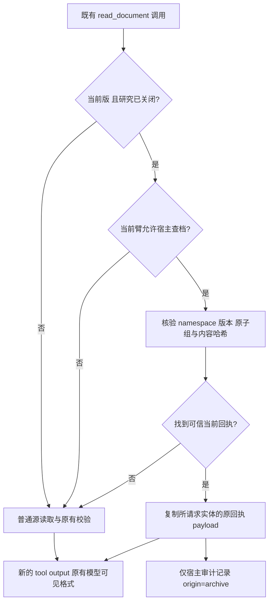

# 统一证据读取入口：宿主优先查档的独立设计

日期2026-10-15。状态：按用户第三项要求完成设计，尚未实现或付费测试。依据：`../../AGENTS_V6_FOLLOWUP_RESULT_20261015.md`及新队列`final-analysis.json`。V6和所有旧运行保持冻结。

## 目标与边界

模型继续使用既有 `read_document(entity, revision)`，宿主在适合时先检查自己已验证的归档，再回退到普通源读取。目的为让已有归档真正进入自然读取路径，并能审计其来源。模型无需额外选择恢复工具，也不强制调用任何工具。

这不是模型主动请求恢复，也不是把旧工具组重插入上下文；它是宿主为一个新的读取调用提供数据。V6来源回执清单保留，当前评分、提示、工具schema、研究归档条件及原恢复TTL均不变。当前范围仅为版本不可变、north/south两份源的现有实验家族；不扩展到任意远程文件、动态仓库或跨任务记忆。

## 三种方案与选择

| 方案 | 价值 | 局限 |
|---|---|---|
| 明确提示模型优先retrieve_evidence | 可继续研究模型选择 | 改变提示偏好，可能制造服从效果；目前没有识别模型选择动机 |
| 既有read_document由宿主优先查档 | 保留自然调用路径，可直接记录真实归档命中 | 相同完整payload不自动降低模型费用 |
| 增加按code选择记录的读取接口 | 有望减少回传内容 | 同时改变查询粒度和工具选择；应独立设计与验证 |

选择第二种作为机制接入的最小候选。第三种属于后续单独的成本优化假设，不混入本候选。

## 读取路径

研究开始前、historical读取及未见源均不从归档伪造当前证据。A0始终普通读，A1保留既有归档但宿主查档关闭，A2允许宿主查档；三臂工具、提示和输出结构相同。A1仍有正常读取回退，不能人为使它失败。

## 验证与返回合同

1. 查询键为本任务namespace、规范化source_path、当前source_version和entity。拒绝任意路径、未知entity及跨任务命中。宿主当前版本来自已验证的任务源；不能把模型给出的版本当成可信控制状态。
2. 仅使用已实际观察并入档的可信read_document输出。检查完整归档组的调用/输出配对、group hash、entry metadata、namespace、source_event_id及当前版本。不得仅凭索引字段匹配就返回正文。
3. 原归档组可能包含north和south。验证整个组后只抽取所请求实体的原始回执payload，不能顺便附带其他实体、旧调用ID或独立评分答案。
4. 返回payload保持字段和值等同普通current读取：kind、entity、path、version、stage和完整text。深拷贝数据，防止调用方修改归档。新SDK调用使用其自己的call_id，不复用归档中的call_id。
5. `origin=archive/source`、命中原因和group_id只写宿主审计日志；不额外加入模型可见payload或提示，避免同时改变模型选择线索。原型先验证最终HTTP数据等值。
6. 错版本、缺失条目、已脱敏或损坏归档均不能算命中。记录拒绝原因，回退到原有、仍须验证当前来源的普通读取。若源本身校验失败，按原规则返回错误或停止，不能用旧归档遮掩版本变化。
7. 实验源保持不可变；原有`verify_sources`不绕过。若发现源发生变化即按当前不可变源合同拒绝，不能静默替换为未经实际读取的新版本。

## 组件与接口（后续实现范围）

新增 `context_pruner/evidence_reader_v7.py`，负责归档验证和读取决策，与模型调用解耦。宿主适配层将归档快照及普通读取回调注入，避免workspace与adapter互相构造。

概念接口：`resolve_current(entity, namespace, current_versions, archive_snapshot, source_loader) -> ReadResolution`。`ReadResolution`保存payload、origin、archive_group_id和拒绝/回退原因；只有payload进入工具响应。archive_snapshot来自当前任务实际archive_store及可信组元数据，不来自模型字符串。

新增独立runner `experiments/runners/run_agents_archive_first_v7.py`，连接workspace读取与resolver、记录宿主origin，同时复用V6清单和边界审计。不得修改冻结V6文件。新增单元/SDK零API测试文件分别验证resolver和宿主桥接；本设计不创建这些产品文件。

原`retrieve_evidence`仍可选，其原始生命周期恢复和TTL2保持原义。宿主查档不会调用私有`_recover`去伪装模型信号，也不改变旧组的恢复租约；返回的新证据结果按原始读取生命周期处理。

## 指标与归因

| 指标 | 定义 |
|---|---|
| 研究后读取请求 | 模型在关闭研究后调用read_document，命中归档也仍计数 |
| 宿主归档命中 | resolver找到并验证的原payload，不等于已发给模型 |
| 归档payload实际投递 | 后续SDK/HTTP边界确实含该新工具输出，并关联真实请求账本 |
| 普通源内容读取/回退 | 实际source_loader调用次数及原因 |
| 来源校验I/O | verify_sources等额外校验读，单列，不声称被缓存消除 |
| 模型缺失信号/生命周期恢复 | 仍按原retrieve_evidence和原子组投递定义计数 |

不能因为origin变为archive就把“自然重读”改记为零。宿主命中不能算模型自主恢复；成功产物也不能单凭时间顺序证明某条归档事实有因果贡献。预算拒绝或传输前停止时，预备命中不能记作已投递。

## 成本判断与零API先行

本轮八次归档臂重读payload与既有归档payload等值。若只是改数据来源、仍回传同样整份JSON，模型输入内容和请求轮次没有必然减少，不能承诺LLM费用节省。当前任务的普通读取本身使用内存任务数据构造正文，且来源校验仍有文件I/O，不能虚称消除了昂贵磁盘读取。

因此先做零API验证：源读取与查档的payload字节等值、正确来源命中、最终工具配对/预算、计数归因。若最终模型输入等值，不为证明“模型账单更低”重复付费；宿主复用能力可以作为独立工程成果。若目标仍是LLM费用，再另立按记录选择/工作集策略的候选，比较完整cache-miss/output费用，不能仅比较JSON长度。

## 最小验证矩阵

- current正确命中；historical绕过；未读源不得命中；A0/A1/A2开关一致可查。
- namespace隔离、同路径旧版、损坏哈希、脱敏内容及不完整原子组均不命中。
- 同组双实体只返回请求实体；新调用ID配对完整；普通与归档payload深拷贝且字节等值。
- 查档未命中能正常回退；源校验失败不被缓存遮掩；当前不可变源合同持续有效。
- 最终wire/输入预算覆盖回传内容，拒绝发送后没有虚假的投递或恢复计数。
- checkpoint重建的归档身份一致；缺少可信状态时明确回退或失败，不能读取其他任务条目。

以上为后续实现的验收条件，不是本次已经通过的测试声明。

## 设计自审与下一阶段

已区分来源标识、完整记录、宿主查档和模型恢复；普通读取回退保留；模型schema/提示不变；错误、版本、I/O、成本与计数边界明确。下一步适合实现resolver并离线验证，不扩大付费队列、不自动进入正式实验。该设计交付后，本次前三项工作结束。
